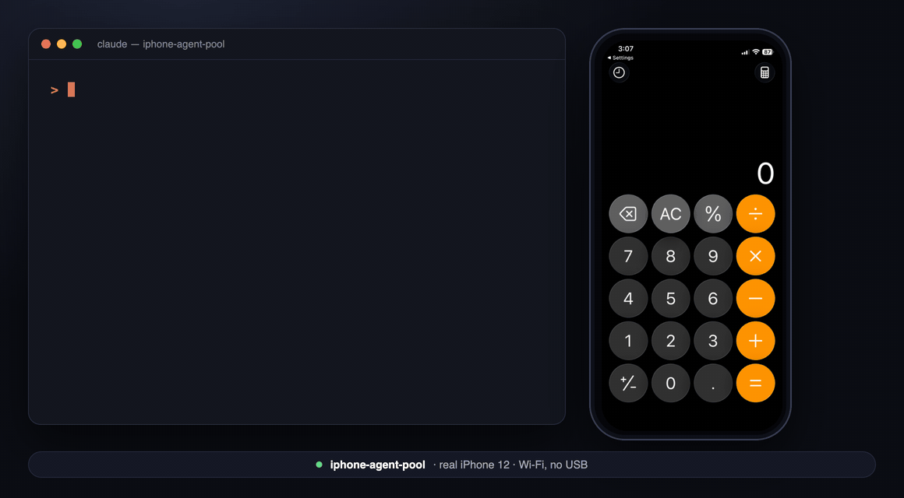

# iPhone Agent Pool

**English** · [中文](README.zh-CN.md)

**Let Claude Code, Codex or any MCP agent drive your real iPhones — wirelessly, from anywhere.**
A self-hosted pool of real iPhones for AI agents: no USB cable, no jailbreak, no VPN on the phone. A Mac keeps each phone's WebDriverAgent alive over Wi-Fi, unlocks it when it sleeps, re-signs it before Apple's free 7-day profile expires, and serves one MCP endpoint per phone that any agent on your Tailscale network can call.



- **Wireless, VPN-proof** — talks to WebDriverAgent through the CoreDevice tunnel Xcode already keeps to the phone (USB or same Wi-Fi). Your Stash/Clash/Surge VPN on the phone keeps working.
- **Hands-off** — a launchd watchdog restarts WDA when it drops and rebuilds/re-signs it 2 days before the free Personal Team profile expires.
- **Wakes itself** — passcode-less pool phones are woken and swiped open before every action.
- **One MCP endpoint per phone** — `http://127.0.0.1:18200/mcp`, `…18201/mcp`, …; one flag publishes them on your tailnet only.
- **Real phone, real apps** — 18 tools: open apps, read the screen as a compact UI tree, tap, swipe, type Chinese or long text, scroll-and-collect lists, live screen preview.

Built on [iPhone Use](https://github.com/zhongerxin/iPhone-use) by ZHONG XIN (MIT), which provides the MCP server and WebDriverAgent tooling for one USB phone. This repo adds the wireless transport, auto-unlock, the multi-phone pool, watchdog/re-signing and remote access.

## Requirements

| | |
|---|---|
| Mac | macOS with full **Xcode** (not just Command Line Tools), Python 3.9+, Node.js 20.19+/22.12+/24+ |
| Phones | **iOS 17 or newer** (iPhone XS / XR and later). iOS 16 phones such as iPhone X/8 cannot be driven by current Xcode. |
| Apple account | Any Apple ID signed into Xcode — a free Personal Team works (profiles last 7 days; the pool re-signs automatically) |
| Remote use (optional) | [Tailscale](https://tailscale.com/download) on the Mac and on the computer running the agent — **not** on the phone |

## Quick start

```sh
git clone https://github.com/risingjerry/iphone-agent-pool.git
cd iphone-agent-pool
python3 pool/iphone_pool.py devices        # find your phone's UDID (plug it in once, tap Trust)
```

Prepare each phone once: **Settings → Privacy & Security → Developer Mode → On**. For a dedicated agent phone also turn off **Stolen Device Protection**, **Reset Face ID**, then **Turn Passcode Off** (iOS requires that order) and keep it on Wi-Fi and a charger.

So agents can **lock the screen** (saves power; the next action unlocks it again): in the Shortcuts app create a shortcut named **`Lock Screen`** with the single action *Lock Screen*, and set **Settings → Notifications → Display As → Count** so a pile of lock-screen notifications cannot swallow the unlock swipe.

```sh
# Team ID: Xcode → Settings → Accounts → your team. Bundle ID: any unique reverse-DNS id you own.
python3 pool/iphone_pool.py add iphone12 --udid <UDID> --team-id <TEAMID> --bundle-id com.yourname.wda
# First time only, on the phone: Settings → General → VPN & Device Management → trust your developer certificate
python3 pool/iphone_pool.py start iphone12
python3 pool/iphone_pool.py install --expose   # background services (+ Tailscale with --expose)
python3 pool/iphone_pool.py status
```

```json
{
  "ok": true,
  "phones": [
    {"name": "iphone12", "ready": true, "wda_port": 18100,
     "mcp_url": "http://127.0.0.1:18200/mcp", "signature_expires": "2026-11-01T05:56:32+00:00"}
  ]
}
```

Now unplug the cable. The phone stays in the pool as long as it is on the same Wi-Fi as the Mac.

## Use with Claude Code / Codex / other agents

```sh
# On the Mac
claude mcp add --transport http iphone12 http://127.0.0.1:18200/mcp
# From any other computer on your tailnet
claude mcp add --transport http iphone12 http://<mac-tailscale-ip>:18200/mcp
```

Codex (`~/.codex/config.toml`):

```toml
[mcp_servers.iphone12]
url = "http://127.0.0.1:18200/mcp"
```

### Use with Grok Bot (or any agent on a cloud computer)

Grok Bot's built-in MCP connectors only reach public URLs, so they cannot see a tailnet address. Its **cloud computer** can: join it to your tailnet and let the bot call the phone with a one-file client. No other agent relays the calls — the bot talks straight to the phone's MCP endpoint on your Mac (the Mac stays in the path because it runs WebDriverAgent through Xcode).

1. On the Mac: `python3 pool/iphone_pool.py install --expose` and note the `tailnet` URL, e.g. `http://100.x.y.z:18200/mcp`.
2. On the cloud computer: install Tailscale and sign in to **the same tailnet** (`curl -fsSL https://tailscale.com/install.sh | sh && sudo tailscale up`).
3. Paste this to your bot (replace the URL):

```text
Set up iPhone control on your cloud computer:
1. mkdir -p ~/bin && curl -fsSL -o ~/bin/phone_client.py https://raw.githubusercontent.com/risingjerry/iphone-agent-pool/main/pool/phone_client.py
2. Test (read-only): python3 ~/bin/phone_client.py --url http://100.x.y.z:18200/mcp call pua_ready '{"screenshot": false}'
3. Remember: to use my iPhone, run `python3 ~/bin/phone_client.py --url <that URL> call <tool> '<json args>'`;
   list tools with `tools`; screenshots: call pua_observe '{"mode":"screenshot"}' --out ./shots, then look at the file.
   Read https://github.com/risingjerry/iphone-agent-pool/blob/main/skills/iphone-use/SKILL.md before the first task.
   Never type passwords or verification codes, never pay; ask me before sending messages, posting or placing orders.
4. Reply with the ready value from step 2.
```

Then just ask it things like *"open Taobao on my iPhone, find X and put the cheapest one in the cart"*. The same client works for any agent that can run shell commands but cannot attach MCP itself:

```sh
python3 phone_client.py --url http://<mac-tailscale-ip>:18200/mcp tools
python3 phone_client.py --url http://<mac-tailscale-ip>:18200/mcp call pua_observe '{"mode":"screenshot"}' --out ./shots
```

Install the bundled skills so the agent sets up and uses the pool correctly:

```sh
npx skills add risingjerry/iphone-agent-pool
# or copy skills/iphone-agent-pool, skills/iphone-use and skills/iphone-use-setup into ~/.claude/skills/
```

Example prompts:

> Use iphone12 to open Notes, create a draft with this text, and read it back to me.
>
> On iphone12, search the App Store for "Tailscale" and tell me the rating and size.
>
> Add my new iPhone 15 to the pool and make it reachable from my laptop.

### Fastest: let a local model do the whole task

A remote agent pays its own thinking time plus a long network round trip for every tap. Hand it the *goal* instead: a fast model running on the Mac next to the phone does all the steps over loopback and reports once. Give it [`pool/phone_operator.md`](pool/phone_operator.md) (tools, speed rules, hard limits, report format) plus the task, e.g. with DeepSeek Harness:

```sh
dsh-run -m deepseek-flash -e low "$(cat pool/phone_operator.md)
URL=http://127.0.0.1:18200/mcp
Task: in the App Store, find Tailscale and report its rating, rating count and size."
```

Measured: App Store lookup (18 tool calls) in 69 s end to end, calculator in 18–28 s, about 2–3× faster than a US cloud agent tapping step by step. Wire it to your messaging layer (e.g. a Yobiru agent with an exec wake adapter) so your remote agent sends one request and gets one answer. The local model stops with `status: blocked` on payments, passwords, sending, posting or submitting orders. Screen contents go to that model's provider, so keep personal phones out of it.

### Make it fast

Most of the time an agent spends is its own thinking between steps, so cut steps:

- **Batch known steps**: `pua_batch` runs up to 20 taps/types/waits in one call (one round trip, one thinking turn).
- **Let actions report back**: `pua_tap`/`pua_press_button`/… take `"observe": "tree"` and return the new screen, so no separate `pua_observe`.
- **Read the tree, not pixels**: `pua_observe` with `"mode": "tree"` and a small `max_nodes` is a few KB; take screenshots only when the tree cannot answer.
- **Call `pua_ready` once per task**, not before every step.
- **Don't lock after every task**: the watchdog locks a pool phone after 3 idle minutes (`IPHONE_POOL_IDLE_LOCK`, seconds; 0 = never), so back-to-back tasks skip the ~3.5 s unlock. `pua_press_button {"name": "lock"}` (~1 s) still locks on demand; the next action unlocks pool phones.
- **Reduce Motion** (Settings → Accessibility → Motion) shortens app transitions on pool phones.

Measured: button press ≈ 0.15 s from a client next to the Mac, ≈ 0.8 s from Grok Bot's cloud computer in the US to a Mac in China (relay ≈ 265 ms round trip). The calculator benchmark (launch, 7 taps + screenshot, lock) takes ≈ 6.8 s locally and ≈ 9–10 s from that cloud computer. `phone_client.py` keeps the connection and MCP session open between calls.

## Commands

Every command prints one JSON object; exit code `0` ok, `1` failed, `2` usage error.

| Command | What it does |
|---|---|
| `devices` | List iPhones Xcode can see, with iOS version and whether they are supported |
| `add NAME --udid --team-id --bundle-id [--on-demand]` | Configure a phone, fetch the pinned WDA, build and sign it; ports are assigned automatically. `--on-demand` for a personal phone (see below) |
| `start NAME` / `stop NAME` | Launch or stop that phone's WDA |
| `install [--expose]` | launchd watchdog + one MCP gateway per phone; `--expose` publishes each port on your tailnet |
| `expose NAME on\|off` | Publish or withdraw one phone on your tailnet (on-demand phones are local-only until you turn this on) |
| `uninstall` | Remove the launchd services and Tailscale serves (phone configs and builds are kept) |
| `status` | Readiness, ports, MCP URL and signature expiry per phone |
| `tick` | One watchdog pass (launchd runs it every 2 minutes) |
| `resign NAME` | Rebuild and re-sign now, then restart |

### Your personal phone: on-demand mode

Keep the passcode, Face ID and everything else. Add it with `--on-demand`: the watchdog never starts it, `--expose` never publishes it (this Mac only, unless you run `expose NAME on`), and it is never auto-unlocked. When you need it (say, to export data from an app), unlock the phone and run `start NAME`; an expired signature is re-signed first. `start` never launches while the phone is locked; it waits for you to unlock it (launching on a locked passcode phone wedges iOS automation mode until a reboot). Leave it running: the runner survives locking and unlocking, so the next task needs no restart; `stop NAME` only when you want it off. After the iPhone reboots, the first `start` must be over USB, then unplug. Only Developer Mode has to be on, plus **Settings → Developer → Enable UI Automation** (a phone with a passcode asks you to confirm automation once on the device; otherwise WDA fails with "Timed out while enabling automation mode").

### Get told when a phone needs you

Some failures only a person can fix (trusting the developer certificate, enabling UI Automation). The watchdog detects them, shows a macOS notification, and — if you set `IPHONE_POOL_NOTIFY` when running `install` — also runs that command with the message as its last argument (Telegram bot, `ntfy`, Slack webhook script…). At most once per problem every 6 hours. A phone that fails to come up 5 times in a row is not restarted forever: the watchdog pauses it for 30 minutes, doubling after each further failed retry up to 6 hours, logs one line and notifies you once. A ready WDA, `start NAME` or a change of connection (plugging in USB) clears the pause; `status` shows `restarts_paused_until`. Failed launches skip Xcode's automatic `devicectl diagnose` bundle (several hundred MB each), so retries do not fill the disk.

```sh
IPHONE_POOL_NOTIFY="/usr/local/bin/my-notify" python3 pool/iphone_pool.py install --expose
```

State lives in `~/.local/share/iphone-use` (override with `IPHONE_POOL_HOME`); logs in `pool-logs/` there.

## How it works

```
agent ──MCP/HTTP──▶ Mac: supergateway ─stdio─▶ iPhone Use MCP server ──▶ 127.0.0.1:181xx
   (tailnet only)                                                         │ forward.mjs
                                                                          ▼
                                     CoreDevice tunnel (USB or Wi-Fi, IPv6) ──▶ WDA :8100 on the phone
```

1. `xcodebuild test-without-building` launches WebDriverAgent on the phone; Xcode reaches the phone over USB or Wi-Fi by itself.
2. With iOS 17+, Xcode keeps an encrypted CoreDevice tunnel to every paired phone and gives it an IPv6 address. The forwarder looks that address up for each connection (`xcrun devicectl device info details`) and connects straight to WDA's port — this works on Wi-Fi and is not affected by a VPN app on the phone. (The legacy usbmux forward fails with current Xcode.)
3. When a phone is locked, the server presses Home and swipes up before acting (`IPHONE_USE_AUTO_UNLOCK=1`; WDA's own `/wda/unlock` times out on iOS 26).
4. The watchdog checks every phone every 2 minutes: restart WDA if it is down and the tunnel is up; rebuild and re-sign when the provisioning profile has less than 2 days left.
5. Each phone's MCP server runs behind [supergateway](https://github.com/supercorp-ai/supergateway) on loopback; `tailscale serve --tcp` publishes the port to your tailnet only.

## Troubleshooting

- **`Developer App Certificate is not trusted`** — on the phone: Settings → General → VPN & Device Management → your developer → Trust. iOS can reset this trust after you change the passcode / Face ID, so trust again after preparing a pool phone.
- **`Timed out while enabling automation mode`** — passcode phone: Settings → Developer → Enable UI Automation, confirm on the phone, then `stop` and `start`.
- **Link previews of shared URLs are grey on the phone** — check that your phone VPN app is actually running; GitHub images are often unreachable without it.

## Limits

- **macOS host only**, and the Mac must stay awake. Phones must be on the **same Wi-Fi as the Mac** for launch and re-signing (Xcode discovers phones with Bonjour, which does not cross Tailscale).
- **iOS 17+** only. Free Personal Team: at most 3 developer apps per phone and 10 App IDs per week.
- A phone **with a passcode** cannot be unlocked by automation — keep it awake or use a dedicated passcode-less phone.
- No authentication on the MCP endpoint: anyone on your tailnet can drive the phone. Keep your tailnet to your own devices.
- Payment, passwords and Face ID prompts are left to a human by design.

## FAQ

### How do I let Claude Code control my iPhone?
Add a phone with `pool/iphone_pool.py add`, start it, then `claude mcp add --transport http iphone12 http://127.0.0.1:18200/mcp`. Claude Code can then open apps, tap, type and read the screen on the real device.

### Can an AI agent control an iPhone without a USB cable?
Yes. After one USB pairing, Xcode keeps a CoreDevice tunnel to the phone over Wi-Fi; this project routes WebDriverAgent through that tunnel, so the cable can go.

### Do I need a paid Apple Developer account?
No. A free Personal Team works; its profiles expire after 7 days and the watchdog re-signs automatically while the phone is on the Mac's Wi-Fi.

### Does it work while the iPhone is locked?
Yes for passcode-less phones: the server wakes and swipes the phone open before each action. With a passcode, iOS never lets automation unlock it.

### Can Grok Bot control my iPhone?
Yes, through its cloud computer: join it to your Tailscale network and give the bot `pool/phone_client.py` (see *Use with Grok Bot*). Grok Bot's built-in MCP connectors only reach public URLs, which this project deliberately does not open.

### Can I control the phone from another computer or while traveling?
Yes. Run `install --expose` and connect your agent to `http://<mac-tailscale-ip>:<port>/mcp` from any device on your Tailscale network. The phone itself stays at home on Wi-Fi; it does not need Tailscale, so your phone VPN keeps working.

### Why can't I add my iPhone X?
iPhone X and 8 stop at iOS 16. Current Xcode only supports the CoreDevice connection on iOS 17+, so they cannot run WebDriverAgent from it.

### Is this a jailbreak or an iPhone Mirroring hack?
Neither. It uses Apple's developer tooling (Xcode, XCTest) and Appium's WebDriverAgent, the same stack mobile QA teams use.

## Uninstall

```sh
python3 pool/iphone_pool.py uninstall
python3 pool/iphone_pool.py stop iphone12
rm -rf ~/.local/share/iphone-use     # phone configs and builds
```

Then delete the `WebDriverAgentRunner` app from each phone.

## Credits and license

MIT. Built on [iPhone Use](https://github.com/zhongerxin/iPhone-use) (MIT, © ZHONG XIN), [WebDriverAgent](https://github.com/appium/WebDriverAgent) and [appium-ios-device](https://github.com/appium/appium-ios-device) (Apache-2.0), and [supergateway](https://github.com/supercorp-ai/supergateway) (MIT). The upstream single-phone guide is kept in [docs/iphone-use.md](docs/iphone-use.md). Unlike upstream, this repo ships **no telemetry keys**, so no usage data is sent anywhere. iPhone and Xcode are trademarks of Apple Inc.; this project is not affiliated with Apple.

If this saved you a USB cable (or a QA lab), a ⭐ helps others find it.

[](https://star-history.com/#risingjerry/iphone-agent-pool&Date)
