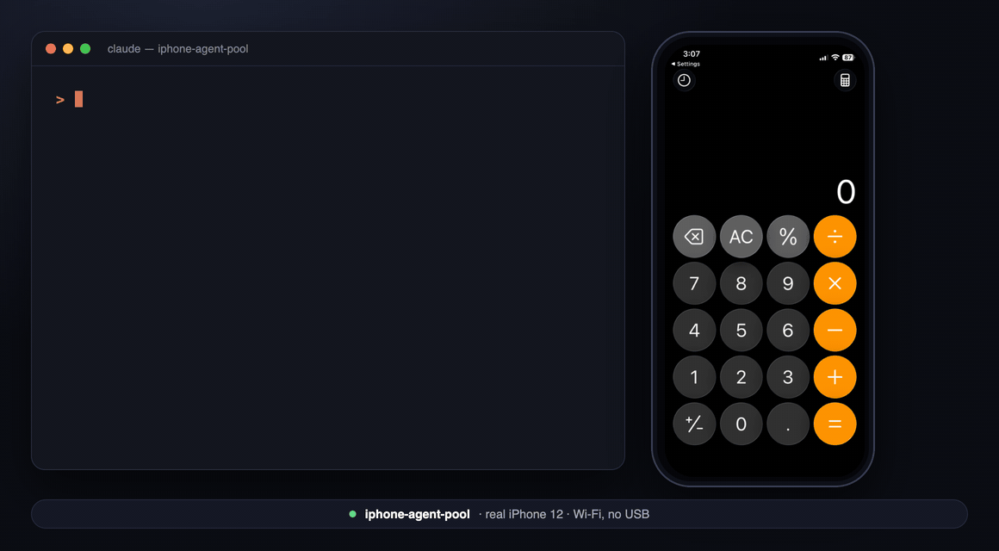

# iPhone Agent Pool

[English](README.md) · **中文**

**让 Claude Code、Codex 或任何 MCP Agent 无线操控你的真实 iPhone，人在哪里都能用。**
这是一个自建的"真机设备池"：不用数据线、不越狱、手机上也不用装 VPN。一台 Mac 通过 Wi-Fi 让每台手机上的 WebDriverAgent 保持在线，手机锁屏了会自动唤醒解锁，苹果免费签名 7 天到期前自动重签，并且给每台手机提供一个 MCP 入口，你 Tailscale 网络里任何一台电脑上的 Agent 都能调用。



- **无线，不怕手机 VPN**：走 Xcode 本来就和手机保持着的 CoreDevice 加密隧道（插线或同一 Wi-Fi 都行）。手机上的 Stash / Clash / Surge 照常开着。
- **不用人管**：后台巡检发现 WDA 掉线会自动拉起；免费开发者账号的签名到期前 2 天自动重新编译签名。
- **自己解锁**：设备池里的手机不设锁屏密码，每次操作前会自动点亮屏幕、上滑解锁。
- **一台手机一个 MCP 入口**：`http://127.0.0.1:18200/mcp`、`…18201/mcp`……加一个参数就只对你的 Tailscale 网络开放。
- **真机真 App**：18 个工具，能打开 App、读取精简的界面树、点击、滑动、输入中文和长文本、滚动采集列表、实时预览屏幕。

基于 ZHONG XIN 的 [iPhone Use](https://github.com/zhongerxin/iPhone-use)（MIT 协议）。原项目提供 MCP 服务和单台 USB 手机的 WebDriverAgent 工具链；本仓库在此基础上加了无线连接、自动解锁、多机设备池、掉线巡检和自动重签，以及远程访问。

## 准备条件

| | |
|---|---|
| Mac | macOS + 完整 **Xcode**（只装命令行工具不够），Python 3.9+，Node.js 20.19+/22.12+/24+ |
| 手机 | **iOS 17 及以上**（iPhone XS / XR 及更新机型）。iPhone X / 8 这类只能到 iOS 16 的机型，新版 Xcode 已经驱动不了 |
| Apple 账号 | 任意在 Xcode 里登录的 Apple ID，免费的 Personal Team 就行（签名 7 天有效，设备池会自动重签） |
| 远程使用（可选） | Mac 和运行 Agent 的电脑上装 [Tailscale](https://tailscale.com/download)，**手机上不用装** |

## 快速开始

```sh
git clone https://github.com/risingjerry/iphone-agent-pool.git
cd iphone-agent-pool
python3 pool/iphone_pool.py devices        # 查手机的 UDID（先插一次线，在手机上点"信任"）
```

每台手机先设置一次：**设置 → 隐私与安全性 → 开发者模式 → 打开**。如果是专门给 Agent 用的手机，再依次关闭**失窃设备保护**、**重置面容 ID**、**关闭密码**（iOS 要求按这个顺序），然后连上 Wi-Fi、插着充电器放好。

要让 Agent 能**锁屏**（省电，下一个动作会自动解锁）：在"快捷指令"App 里新建一个名叫 **`Lock Screen`** 的快捷指令，里面只放一个"锁定屏幕"动作；再把 **设置 → 通知 → 显示为 → 数量** 打开，免得锁屏上一大串通知把解锁手势吃掉。

```sh
# Team ID 在 Xcode → 设置 → Accounts 里看；Bundle ID 随便起一个属于你的唯一反向域名
python3 pool/iphone_pool.py add iphone12 --udid <UDID> --team-id <TEAMID> --bundle-id com.yourname.wda
# 仅第一次：手机上 设置 → 通用 → VPN 与设备管理 → 信任你的开发者证书
python3 pool/iphone_pool.py start iphone12
python3 pool/iphone_pool.py install --expose   # 装后台服务（加 --expose 同时开放到 Tailscale）
python3 pool/iphone_pool.py status
```

```json
{
  "ok": true,
  "phones": [
    {"name": "iphone12", "ready": true, "wda_port": 18100,
     "mcp_url": "http://127.0.0.1:18200/mcp", "signature_expires": "2026-11-01T05:56:32+00:00"}
  ]
}
```

现在可以拔掉数据线了。只要手机和 Mac 连着同一个 Wi-Fi，它就一直在设备池里。

## 在 Claude Code / Codex / 其他 Agent 里使用

```sh
# 在 Mac 本机
claude mcp add --transport http iphone12 http://127.0.0.1:18200/mcp
# 在 Tailscale 网络里的其他电脑上
claude mcp add --transport http iphone12 http://<Mac 的 Tailscale IP>:18200/mcp
```

Codex（`~/.codex/config.toml`）：

```toml
[mcp_servers.iphone12]
url = "http://127.0.0.1:18200/mcp"
```

### 在 Grok Bot（或任何云电脑上的 Agent）里使用

Grok Bot 自带的 MCP 连接器只能连公网地址，连不到 Tailscale 内网。但它的**云电脑**可以：让云电脑加入你的 Tailscale 网络，再用一个单文件客户端去调手机。中间不经过任何别的 Agent 转手，bot 直接调用 Mac 上的手机 MCP 入口（Mac 这一环省不掉，因为 WebDriverAgent 要靠 Mac 上的 Xcode 启动）。

1. 在 Mac 上：运行 `python3 pool/iphone_pool.py install --expose`，记下输出里 `tailnet` 那个地址，比如 `http://100.x.y.z:18200/mcp`。
2. 在云电脑上：装 Tailscale 并登录**同一个网络**（`curl -fsSL https://tailscale.com/install.sh | sh && sudo tailscale up`）。
3. 把下面这段话发给你的 bot（地址换成你自己的）：

```text
请在你的云电脑上配置 iPhone 操控：
1. mkdir -p ~/bin && curl -fsSL -o ~/bin/phone_client.py https://raw.githubusercontent.com/risingjerry/iphone-agent-pool/main/pool/phone_client.py
2. 测试（只读）：python3 ~/bin/phone_client.py --url http://100.x.y.z:18200/mcp call pua_ready '{"screenshot": false}'
3. 记住用法：操作我的 iPhone 时运行 `python3 ~/bin/phone_client.py --url <上面的地址> call <工具名> '<JSON 参数>'`；
   用 `tools` 看工具列表；截图用 call pua_observe '{"mode":"screenshot"}' --out ./shots 再看图片文件。
   第一次干活前先读 https://github.com/risingjerry/iphone-agent-pool/blob/main/skills/iphone-use/SKILL.md
   不输密码和验证码，不付款；发消息、发帖、下单前先问我。
4. 把第 2 步返回的 ready 结果回复给我。
```

之后直接跟它说"在我手机上打开淘宝，搜 X，把最便宜的加进购物车"就行。其他能跑命令、但不能自己接 MCP 的 Agent 也能用同一个客户端：

```sh
python3 phone_client.py --url http://<Mac 的 Tailscale IP>:18200/mcp tools
python3 phone_client.py --url http://<Mac 的 Tailscale IP>:18200/mcp call pua_observe '{"mode":"screenshot"}' --out ./shots
```

装上仓库自带的技能，Agent 就知道怎么配置和使用设备池：

```sh
npx skills add risingjerry/iphone-agent-pool
# 或者把 skills/iphone-agent-pool、skills/iphone-use、skills/iphone-use-setup 复制到 ~/.claude/skills/
```

可以这样跟 Agent 说：

> 用 iphone12 打开备忘录，新建一条草稿写入这段文字，再读出来给我核对。
>
> 在 iphone12 的 App Store 里搜 "Tailscale"，告诉我评分和安装包大小。
>
> 把我新买的 iPhone 15 加进设备池，让我笔记本上也能用。

### 最快：让本地模型把整件事做完

远程 Agent 每点一下，都要付出自己的思考时间加上一趟长途网络来回。不如只把**目标**交出去：由 Mac 上、紧挨着手机的快模型通过本机回环把所有步骤做完，只汇报一次。给它 [`pool/phone_operator.md`](pool/phone_operator.md)（工具用法、提速规则、硬性边界、汇报格式）再加上任务，比如用 DeepSeek Harness：

```sh
dsh-run -m deepseek-flash -e low "$(cat pool/phone_operator.md)
URL=http://127.0.0.1:18200/mcp
任务：在 App Store 里找到 Tailscale，告诉我评分、评分人数和大小。"
```

实测：App Store 查询（18 次工具调用）端到端 69 秒，计算器 18 到 28 秒，比美国的云端 Agent 一步步点快 2 到 3 倍。把它接到你的消息通道上（比如一个带 exec 唤醒适配器的 Yobiru 收件人），远程 Agent 发一条请求、收一条结果即可。遇到付款、密码、发消息、发帖、提交订单，本地模型会停下并回 `status: blocked`。屏幕内容会发给这个模型的服务商，所以私人手机不要接进来。

### 让它更快

Agent 花的时间大部分是它每一步之间自己思考，所以关键是**减少步数**：

- **已知的连续操作一次发完**：`pua_batch` 一次最多执行 20 个点击/输入/等待，只要一个来回、一轮思考。
- **让动作顺便返回屏幕**：`pua_tap`、`pua_press_button` 等都能带 `"observe": "tree"`，做完直接返回新画面，不用再单独调 `pua_observe`。
- **读界面结构，少截图**：`pua_observe` 用 `"mode": "tree"` 配小一点的 `max_nodes`，只有几 KB；结构看不出来时才截图。
- **每个任务只调一次 `pua_ready`**，不要每一步都调。
- **不用每个任务都锁屏**：巡检会在设备池手机闲置 3 分钟后自动锁屏（`IPHONE_POOL_IDLE_LOCK`，单位秒，0 表示不自动锁），连续的任务就省掉了约 3.5 秒的解锁。需要时仍可用 `pua_press_button {"name": "lock"}`（约 1 秒）手动锁，下一个动作会自动解锁。
- **打开"减弱动态效果"**（设置 → 辅助功能 → 动态效果），设备池手机的页面切换会更快。

实测：按一次键，Mac 旁边的客户端约 0.15 秒，从美国的 Grok Bot 云电脑到国内 Mac 约 0.8 秒（中转一个来回约 265 毫秒）。计算器测速任务（打开、点 7 下加截图、锁屏）在本机约 6.8 秒，从那台云电脑约 9 到 10 秒。`phone_client.py` 会在多次调用之间保持连接和 MCP 会话。

## 命令一览

每条命令都输出一个 JSON；退出码 `0` 成功，`1` 失败，`2` 参数错误。

| 命令 | 作用 |
|---|---|
| `devices` | 列出 Xcode 能看到的 iPhone，含 iOS 版本和是否支持 |
| `add 名字 --udid --team-id --bundle-id [--on-demand]` | 配置一台手机，下载固定版本的 WDA，编译并签名；端口自动分配。主力手机加 `--on-demand`（见下文） |
| `start 名字` / `stop 名字` | 启动或停止这台手机的 WDA |
| `install [--expose]` | 装后台巡检和每台手机的 MCP 入口；`--expose` 把端口开放到你的 Tailscale 网络 |
| `expose 名字 on\|off` | 把某台手机开放到 Tailscale 或收回（按需模式的手机默认只限本机，开了才开放） |
| `uninstall` | 删掉后台服务和 Tailscale 端口转发（手机配置和编译结果保留） |
| `status` | 每台手机是否就绪、端口、MCP 地址、签名到期时间 |
| `tick` | 巡检一次（后台每 2 分钟自动跑一次） |
| `resign 名字` | 立刻重新编译签名，再重启 |

### 主力手机：按需模式

密码、面容 ID 都不用关。用 `--on-demand` 加进来：巡检不会自动启动它，`--expose` 也不会把它开放到 Tailscale（只有这台 Mac 能连，除非你运行 `expose 名字 on`），也不会自动解锁。要用的时候（比如从某个 App 里导数据），先解锁手机，运行 `start 名字`；签名过期了会先自动重签。手机锁着时 `start` 绝不启动，会等你解锁（带密码的手机在锁屏时启动会把 iOS 自动化授权卡死，只能重启手机）。启动后就让它一直开着：锁屏再解锁它照样能用，下次用不用重启；只有你想关时才 `stop 名字`。手机重启后，第一次 `start` 要插着数据线，成功后再拔。只需要打开开发者模式，再打开 **设置 → 开发者 → 启用 UI 自动化**（有密码的手机第一次会让你在手机上确认一次；不开会报 "Timed out while enabling automation mode"）。

### 手机需要你动手时通知你

有些故障只能人来点（信任开发者证书、启用 UI 自动化）。巡检发现后会弹 macOS 通知；如果 `install` 时设置了 `IPHONE_POOL_NOTIFY`，还会把提示文字作为最后一个参数去执行这个命令（Telegram 机器人、`ntfy`、Slack 脚本都行）。同一个问题 6 小时内只提醒一次。

```sh
IPHONE_POOL_NOTIFY="/usr/local/bin/my-notify" python3 pool/iphone_pool.py install --expose
```

数据放在 `~/.local/share/iphone-use`（可用 `IPHONE_POOL_HOME` 改），日志在它下面的 `pool-logs/`。

## 原理

```
Agent ──MCP/HTTP──▶ Mac：supergateway ─stdio─▶ iPhone Use MCP 服务 ──▶ 127.0.0.1:181xx
  （只对 Tailscale 开放）                                                 │ forward.mjs
                                                                         ▼
                                   CoreDevice 隧道（USB 或 Wi-Fi，IPv6）──▶ 手机上的 WDA :8100
```

1. 用 `xcodebuild test-without-building` 在手机上启动 WebDriverAgent，Xcode 自己会通过 USB 或 Wi-Fi 找到手机。
2. iOS 17 起，Xcode 会和每台配对过的手机保持一条加密的 CoreDevice 隧道，并给它分配一个 IPv6 地址。转发程序每次连接时查一下这个地址（`xcrun devicectl device info details`），直接连到 WDA 的端口。这条路 Wi-Fi 下也能用，而且不受手机上 VPN App 的影响。原来的 usbmux 转发在新版 Xcode 上已经连不通了。
3. 手机锁屏时，服务会先按一下 Home、再上滑解锁（`IPHONE_USE_AUTO_UNLOCK=1`；WDA 自带的 `/wda/unlock` 在 iOS 26 上会超时）。
4. 巡检每 2 分钟看一次每台手机：WDA 掉线并且隧道是通的，就重新拉起；签名剩不到 2 天，就重新编译签名。
5. 每台手机的 MCP 服务通过 [supergateway](https://github.com/supercorp-ai/supergateway) 只监听本机；`tailscale serve --tcp` 把端口只开放给你的 Tailscale 网络。

## 常见故障

- **`Developer App Certificate is not trusted`**：在手机上 设置 → 通用 → VPN 与设备管理 → 你的开发者 → 信任。改过锁屏密码或面容 ID 后，iOS 可能会清掉这个信任，准备好设备池手机后要重新信任一次。
- **`Timed out while enabling automation mode`**：有密码的手机要打开 设置 → 开发者 → 启用 UI 自动化，在手机上确认后再 `stop`、`start`。
- **手机上分享链接预览是灰色的**：先确认手机上的代理 App 真的开着，国内直连经常加载不了 GitHub 的图片。

## 限制

- **只能用 Mac 当主机**，而且 Mac 要一直开着。启动 WDA 和重签时，手机必须和 **Mac 在同一个 Wi-Fi**（Xcode 用 Bonjour 找手机，跨不了 Tailscale）。
- 只支持 **iOS 17 及以上**。免费账号每台手机最多 3 个开发版 App，每周最多 10 个 App ID。
- **设了锁屏密码的手机**，自动化没法解锁。要么一直亮屏，要么用专门的无密码手机。
- MCP 入口没有鉴权：你 Tailscale 网络里的任何设备都能操控手机，所以 Tailscale 里只放你自己的设备。
- 付款、输密码、刷脸这类操作按设计都交给人来做。

## 常见问题

### 怎么让 Claude Code 操控我的 iPhone？
用 `pool/iphone_pool.py add` 加手机、启动，再运行 `claude mcp add --transport http iphone12 http://127.0.0.1:18200/mcp`。之后 Claude Code 就能在真机上打开 App、点击、输入、读屏幕。

### AI Agent 能不插数据线控制 iPhone 吗？
能。插线配对一次之后，Xcode 会通过 Wi-Fi 和手机保持 CoreDevice 隧道，本项目让 WebDriverAgent 走这条隧道，线就可以拔了。

### 需要付费的苹果开发者账号吗？
不需要。免费的 Personal Team 就行，签名 7 天过期，只要手机和 Mac 在同一个 Wi-Fi，巡检会自动重签。

### 手机锁屏了还能用吗？
没设密码的手机可以：每次操作前服务会自动点亮并上滑解锁。设了密码的手机，iOS 不允许任何自动化去解锁。

### Grok Bot 能操控我的 iPhone 吗？
能，通过它的云电脑：让云电脑加入你的 Tailscale 网络，再把 `pool/phone_client.py` 交给 bot（见"在 Grok Bot 里使用"）。Grok Bot 自带的 MCP 连接器只能连公网地址，而本项目刻意不把手机入口开到公网。

### 能在别的电脑上、或者出门在外时控制家里的手机吗？
能。运行 `install --expose`，然后在 Tailscale 网络里的任意设备上让 Agent 连 `http://<Mac 的 Tailscale IP>:<端口>/mcp`。手机本身放在家里连 Wi-Fi，不用装 Tailscale，所以手机上的 VPN 照常能用。

### 为什么加不了我的 iPhone X？
iPhone X 和 8 最高只能升到 iOS 16。新版 Xcode 只在 iOS 17 及以上支持 CoreDevice 连接，没法给它们启动 WebDriverAgent。

### 这是越狱，或者破解了 iPhone 镜像吗？
都不是。它用的是苹果官方的开发工具（Xcode、XCTest）和 Appium 的 WebDriverAgent，和移动端测试团队用的是同一套东西。

## 卸载

```sh
python3 pool/iphone_pool.py uninstall
python3 pool/iphone_pool.py stop iphone12
rm -rf ~/.local/share/iphone-use     # 手机配置和编译结果
```

最后在每台手机上删掉 `WebDriverAgentRunner` 这个 App。

## 致谢与协议

MIT 协议。基于 [iPhone Use](https://github.com/zhongerxin/iPhone-use)（MIT，© ZHONG XIN）、[WebDriverAgent](https://github.com/appium/WebDriverAgent) 和 [appium-ios-device](https://github.com/appium/appium-ios-device)（Apache-2.0）、[supergateway](https://github.com/supercorp-ai/supergateway)（MIT）。上游的单机说明保留在 [docs/iphone-use.zh-CN.md](docs/iphone-use.zh-CN.md)。和上游不同，本仓库**不带任何统计密钥**，不会把使用数据发到任何地方。iPhone 和 Xcode 是 Apple Inc. 的商标，本项目与 Apple 无关。

如果它帮你省了一根数据线（或者一个测试机房），点个 ⭐ 能让更多人找到它。

[](https://star-history.com/#risingjerry/iphone-agent-pool&Date)
